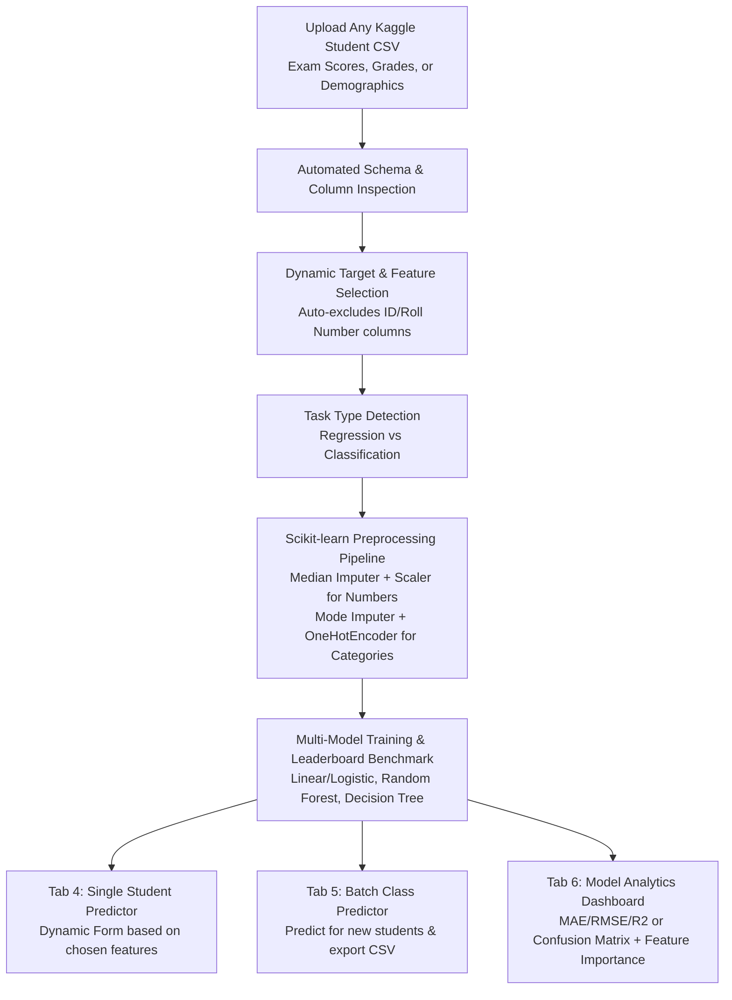

# 🎓 Dynamic Student Performance Prediction System (Machine Learning Project)

> **Domain:** Educational Data Mining & Supervised Machine Learning  
> **Course / Degree:** MCA Mini / Final Project  
> **Core Framework:** Streamlit, Python, Scikit-learn, Pandas, NumPy, Matplotlib, Seaborn  
> **Status:** Production-Ready & Tested

---

## 📌 Project Overview
The **Dynamic Student Performance Prediction System** is a flexible, dataset-agnostic machine learning application designed to predict student academic outcomes—such as numerical exam marks, letter grades ('A', 'B', 'C', 'D', 'F'), or binary pass/fail results.

Unlike rigid systems that require hardcoded column names or a single fixed CSV file, this platform accepts **any student academic dataset** (e.g., downloaded from Kaggle), detects column types, dynamically generates preprocessing pipelines, trains and benchmarks multiple machine learning models, and provides interactive single-student and batch prediction capabilities.

---

## 🏗️ System Architecture & Workflow



---

## 🚀 Key Features

1. **Dynamic CSV Ingestion:**
   - Upload any academic CSV file without rigid column name dependencies.
   - Real-time schema inspection: total rows, total columns, missing values count/percentages, detected data types, and descriptive statistics.
2. **Automatic Task Type Detection:**
   - Continuously evaluates the target column: detects **Regression** (for continuous scores/marks) or **Classification** (for letter grades, pass/fail categories).
   - Allows user confirmation or manual override.
3. **Smart Identifier Protection:**
   - Automatically detects and deselects student IDs, roll numbers, registration numbers, and names (`Student_ID`, `Roll_No`, `Name`, etc.) to prevent data leakage.
4. **Reproducible Machine Learning Pipelines:**
   - Uses `ColumnTransformer` fitted **strictly on the training split**, completely preventing data leakage.
   - Handles missing numbers via median imputation + `StandardScaler`.
   - Handles missing text categories via most-frequent imputation + `OneHotEncoder(handle_unknown='ignore')`.
5. **Multi-Model Benchmarking:**
   - **Regression:** Linear Regression, Random Forest Regressor, Decision Tree Regressor (evaluated via MAE, MSE, RMSE, R² Score).
   - **Classification:** Logistic Regression, Random Forest Classifier, Decision Tree Classifier (evaluated via Accuracy, Precision, Recall, F1-Score).
   - Dynamic Leaderboard recommending the top model.
6. **Single Student Inference:**
   - Dynamically constructs input forms (sliders/numbers for continuous values, selectboxes for categorical features).
   - Provides instant predicted score cards, progress bars, or class probability breakdowns.
7. **Batch Prediction & Class CSV Upload:**
   - Upload a roster of new students (with or without target columns).
   - Applies the learned preprocessing pipeline and appends `Predicted_<Target>`.
   - Generates summary statistics and downloadable CSV reports.
8. **Comprehensive Model Analytics:**
   - Regression: Actual vs. Predicted scatter plot with ideal $y = x$ reference line, residual distribution curve.
   - Classification: Confusion Matrix heatmap, full classification report per class.
   - Feature Importance: Horizontal bar chart highlighting the academic drivers of student success.

---

## 📁 Project Directory Structure

```
d:/OneDrive/Desktop/ML_Mini_Project/
│
├── app.py                                                # Main Streamlit Web Application (6 Tabs)
├── requirements.txt                                      # Python library dependencies
├── README.md                                             # Project guide & documentation
│
├── data/
│   ├── kaggle_student_performance_train.csv              # Realistic Kaggle sample dataset (500 students)
│   ├── kaggle_student_prediction_batch.csv               # Unlabelled batch sample for testing (50 students)
│   ├── student_data.csv                                  # Original attendance & marks dataset (600 students)
│   └── clustered_students.csv                            # Preserved historical clustered dataset
│
├── src/
│   ├── ml_engine.py                                      # Reusable Supervised Machine Learning engine
│   ├── generate_kaggle_samples.py                        # Kaggle sample dataset generator
│   ├── train_model.py                                    # Preserved K-Means clustering pipeline
│   ├── predict.py                                        # Preserved CLI prediction utility
│   ├── compare_models.py                                 # Preserved clustering benchmark script
│   └── create_notebook.py                                # Jupyter notebook generator
│
├── notebooks/
│   └── student_performance_clustering.ipynb              # Preserved step-by-step Jupyter Notebook
│
├── docs/
│   ├── PROJECT_REPORT.md                                 # Formal college project documentation
│   └── PRESENTATION_SLIDES.md                            # Slide-by-slide presentation outline
│
└── visual_outputs/                                       # Generated evaluation and comparison plots
    ├── algorithm_comparison.png
    ├── cluster_profiles.png
    ├── correlation_heatmap.png
    ├── elbow_method.png
    ├── pca_clusters_2d.png
    └── silhouette_scores.png
```

---

## 💻 How to Run in VS Code (Windows)

### 1. Open Terminal in VS Code
Open the project folder `d:\OneDrive\Desktop\ML_Mini_Project` in VS Code, then open a **PowerShell** or **Command Prompt** terminal (`Ctrl + ~`).

### 2. Verify or Activate Virtual Environment (Optional)
If using a virtual environment:
```powershell
# If using existing .venv:
.\.venv\Scripts\Activate.ps1
```

### 3. Install Requirements
```powershell
pip install -r requirements.txt
```

### 4. Launch the Streamlit Application
```powershell
streamlit run app.py
```
Streamlit will automatically open your browser at **`http://localhost:8501`**.

---

## 🌐 Instructions for Kaggle Datasets

### How to Download from Kaggle:
1. Go to [kaggle.com/datasets](https://www.kaggle.com/datasets).
2. Search for:
   - `"Student Performance"`
   - `"Students Exam Scores"`
   - `"Student Grades Dataset"`
   - `"Higher Education Students Performance"`
3. Click on the dataset and click **Download** (a `.zip` file).
4. Extract the `.csv` file onto your computer.

### How to Use in this Application:
1. Open the application at `http://localhost:8501`.
2. Go to **Tab 2: 📂 Upload Dataset**.
3. Drag and drop your downloaded Kaggle `.csv` file.
4. Review the data preview, row counts, missing values, and column schema.
5. Go to **Tab 3: ⚙️ Train Model**:
   - Choose your Target (e.g., `Exam_Score`, `math score`, `Grade`, or `Pass/Fail`).
   - Choose your Input Features (the app automatically excludes Student IDs).
   - Click **🚀 Train Machine Learning Models**.
6. Go to **Tab 4: 🔮 Predict Student Marks** to test an individual student.
7. Go to **Tab 5: 📁 Batch Prediction** to upload a class CSV and download predictions.
8. Go to **Tab 6: 📊 Model Analytics** to view the confusion matrix, regression fit, and feature importance chart.

---

## 🧪 Built-in Test Datasets Included

You can test the entire workflow immediately without downloading external files:
- **`data/kaggle_student_performance_train.csv`**: Contains 500 students with mixed numerical and categorical features (`Gender`, `Parental_Education`, `Internet_Access`, `Extracurricular`, `Study_Hours_Weekly`, `Attendance_Rate`, `Previous_Score`, `Tutoring_Sessions`) with targets:
  - Numerical Target: `Exam_Score` (Regression)
  - Multi-class Target: `Final_Grade` ('A', 'B', 'C', 'D', 'F')
  - Binary Target: `Pass_Fail` ('Pass', 'Fail')
- **`data/kaggle_student_prediction_batch.csv`**: Contains 50 unlabelled students to test batch CSV uploads in Tab 5.
